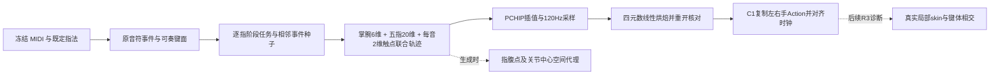

# 当前右手连续运动架构：基于代码的还原

本轮 ARCHITECTURE_REASSESSMENT_ONLY。只读代码与已有结果；没有导入运动模块、打开Blender、运行FK/蒙皮/碰撞检查或任何优化。事件阶段表只对已有JSON时钟做算术解释，不是新运动数据。历史Human批准、WARN与FAIL_CLOSED原样保留。

## 实际链路

1. **音乐与指法**：上游读取原MIDI右手track 1、ticks 0–4608、PPQ384、tempo428571，赋予预先锁定的16项指法 `[5,1,2,3,4,5,1,1,5,3,4,3,4,5,1,1]`。这不是自动指法，也不是训练过的演奏策略。A2复制已有timeline并保持指法，没有重新运行旧R1的root规划器。证据：[00_scope.py:27](../../../artifacts/c220b5f71df9766b4d29.md)、[01_preflight.py:4](../../../artifacts/c8aaa14b89e26e76f13f.md)。
2. **键面目标**：EventCoordinator从冻结键表读取目标键可奏面第一片，白键内缩3/7 mm、黑键2/2 mm；触点XY初值由键中心及R1静态锚点纵深给出。每音XY是联合变量，限制在内缩键面，Z为键面+0.5 mm并随目标键旋转。证据：[coordinated_motion.py:40](../../../artifacts/f616566d89a0ecfe8d3a.md)。
3. **掌腕与五指**：每支撑时刻26维状态（root平移3、额外旋转3、每指3屈伸+1横展共20），加每音2维触点。使用既有冻结FK轴与标记；root不是预先写死的轨迹。基准手型为单一R1锚点NEUTRAL，关节和root有显式变量域。证据：[coordinated_motion.py:20](../../../artifacts/15cbc4f5009c9b8e1b00.md)。
4. **活动、准备、释放与闲置**：`tasks(t)`逐指按 ACTIVE > RELEASE_FOLLOW > PREPARE 优先级选一个任务。活动时追随运动键面；NOTE_OFF后40 ms仍跟随原键，抬升最多2 mm，接触权重由6降到4.2；下一次同指音符开始前180 ms进入准备，前段最多悬高9 mm，最后75 ms下降，准备权重平滑增至4。没有任务的手指并非固定不动：所有指一直受NEUTRAL软先验及时间平滑影响，闲置pad另有5 mm高度软约束。它们没有根据邻指占据空间制定的独立准备通道。证据：[coordinated_motion.py:89](../../../artifacts/b9f43495a87a24fa199f.md)、[coordinated_motion.py:128](../../../artifacts/f01de84f59a7ce47fc92.md)、[02_generate.py:51](../../../artifacts/6eb2250cc3b274e3319e.md)。
5. **重复音机械模型**：最后45 ms部分释放至pressure0.42，下一NOTE_ON后35 ms重新下沉；由最新同键事件拥有机械状态，MIDI事件不变。此逻辑需原样保留，不能在新协调器内另造键时钟。证据：[coordinated_motion.py:60](../../../artifacts/75551fee312ca4caad64.md)。
6. **联合轨迹求解**：事件ON/OFF邻域加约90 ms网格生成支撑点；按当前音与下一不同指音（8 mm准备高度）静态求解生成种子，然后所有支撑点的root和五指再次联合优化，不是五个互不关联的IK求解。各点触键、pad—键体代理、关节中心高度、姿态先验与相邻点速度/加速度全部进入一个带稀疏Jacobian的有界least_squares。变量边界是硬域，其余这些残差是加权软项。证据：[02_generate.py:11](../../../artifacts/df4ff82d402de1555e3c.md)、[02_generate.py:20](../../../artifacts/475f9a45e5f5204120e3.md)、[02_generate.py:51](../../../artifacts/6eb2250cc3b274e3319e.md)、[02_generate.py:92](../../../artifacts/4bcf4e22f7115c7eb9ef.md)。
7. **求解结果与插值**：保存结果为195支撑点、5102参数，达到75次nfev上限，`success=false`；代码仍在有限性与变量域检查后保存结果。这不抹去历史Human接受，也不能视为收敛或空间可行性证书。随后按状态分量PCHIP插值，120 Hz及额外事件点采样。PCHIP的C1性质不等于实际Blender烘焙或空间净空成立。证据：[COORDINATED_TRAJECTORY_FIT.json](../../../artifacts/4173941bf114e3fe7f55.md)、[02_generate.py:98](../../../artifacts/ef02d3ced56d27d99c3a.md)。
8. **烘焙**：从批准静态场景复制派生场景；围绕锚腕应用root变换；各指局部旋转转四元数、连续符号，插入LINEAR关键帧。运动琴键单独绑定pivot。保存重开，比较FK/实际pad及键体变换，保存实际skin供诊断。没有在烘焙阶段重新求解空间关系。证据：[03_scene.py:34](../../../artifacts/f9ac2421875315e46261.md)。
9. **C1双手合成**：从批准左右手复制root、rig、键Action，仅右手时间原点+3帧、左手+0帧；键帧值与LINEAR模式保持，单一键盘与音频。C1原演示=音乐+0.35 s，A2=音乐+0.30 s。合成时核对源动作保持、双手x包络及有限接触，没有规划右手内部避碰。证据：[03_integrate.py:31](../../../artifacts/64051ac4149f0c692298.md)、[03_integrate.py:115](../../../artifacts/192b5496c50ebe2a698d.md)。

## 空间能力边界

| 能力 | A2/C1实际状态 | 后续补丁 | 尚缺失 |
|---|---|---|---|
| 五指与root联合变量 | 已实现 | R4只有三指静态，有限root增加5参数 | 无需从零重建FK |
| 音符阶段 | 已有逐指活动/准备/短释放 | R4活动pad和70 ms释放floor | 跨指占用、释放与下一准备的协调计划 |
| 键体空间 | 生成时已有附近白/黑键体box的pad约束，动态主求解使用运动键逆变换 | R3实际skin诊断；R4四指局部skin顶点对七黑键 | 连续表面、非目标白键及所有受root影响手指的一致保护 |
| 邻指空间 | 没有直接指—指残差 | R2单MCP偏移；R4三个相邻指对的局部最近顶点法向场 | 与事件轨迹联合的稳定皮肤分离约束 |
| 自然度与连续性 | 单一静态先验、速度/加速度软项，PCHIP | R4以原姿态增量为先验 | 任务条件化的手型先验与连续避让通道 |
| 验收 | 触点/有限skin采样与Human观看 | R3/R4实际表面检查并保留失败 | 生成中空间可行优先与保存后独立一致门禁 |

A2不是“完全不考虑黑键”：其主求解对局部音域键体做运动坐标转换，但只有pad点；近端/PIP/DIP中心的高度代理仍取静态box顶面、低权重。静态种子中的pad box也为静止键体，并对被任务拥有且weight>1的键允许−4 mm裕量；主求解对应裕量是0。准备任务weight>1也会得到该键豁免，不只真正活动触键。这些都不同于真实皮肤安全证明。证据：[02_generate.py:41](../../../artifacts/975c9ef03c668d257fc4.md)、[02_generate.py:51](../../../artifacts/6eb2250cc3b274e3319e.md)。A2后验只取每指附近少量skin点与掌部点、每音两个时刻，没有邻指皮肤相交检查：[04_diagnostics.py:37](../../../artifacts/b819027d56116ee11bb8.md)。

## 事件阶段的关键澄清

| C1演示秒 | 音乐秒 | 食指 | 中指 | 无名指 | 小指 |
|---|---|---|---|---|---|
| 1.1083333 | 0.7583333 | ACTIVE A4 | PREPARE B4 | IDLE | IDLE |
| 1.1333333 | 0.7833333 | ACTIVE A4 | PREPARE B4 | IDLE | IDLE |
| 1.1916667 | 0.8416667 | ACTIVE A4 | PREPARE B4 | IDLE | IDLE |
| 1.2500000 | 0.9000000 | IDLE | ACTIVE B4 | PREPARE C5 | IDLE |
| 1.4214275 | 1.0714275 | IDLE | RELEASE_FOLLOW B4 | ACTIVE C5 | IDLE |
| 3.7500000 | 3.4000000 | IDLE | PREPARE E5 | ACTIVE D5 | IDLE |
| 3.8128535 | 3.4628535 | IDLE | ACTIVE E5 | RELEASE_FOLLOW D5 | IDLE |
| 3.8185680 | 3.4685680 | IDLE | ACTIVE E5 | PREPARE F#5 | IDLE |
| 3.8250000 | 3.4750000 | IDLE | ACTIVE E5 | PREPARE F#5 | IDLE |
| 3.8500000 | 3.5000000 | IDLE | ACTIVE E5 | PREPARE F#5 | IDLE |

以上来自原 [PERFORMANCE_TIMELINE.json](../../../artifacts/e51b96ded05f2b813cfb.md) 与A2角色分支，不重新执行规划。

- 早段1.108–1.192 s：食指A4持键，中指准备B4；无名指要到1.2414275 s才显式准备C5，因此该段应称“中指准备、无名指未分配任务”，不能笼统写两指都有准备目标。无名指仍可能受未来支撑点平滑影响而提前运动。
- 晚段：D5由无名指持键，3.778568 s释放；A2释放跟随结束3.818568 s。F♯5准备窗从3.8128535 s开始，约5.7145 ms与释放窗重叠，优先级使释放先执行。到3.825 s无名指已是F♯5 PREPARE，而非A2的RELEASE_FOLLOW。
- R4另以NOTE_OFF+70 ms设置释放floor，因此3.825 s仍受旧D5键面的下界影响，却没有显式F♯5准备任务。这是两个不同模型的已证差异；不能把R4说成原A2连续阶段规划的完整延续。证据：[coordination.py:111](../../../artifacts/d61ac0775a1b614f5668.md)。历史报告中“释放过程”可描述音乐语义，本轮细化算法状态而不改历史记录。
